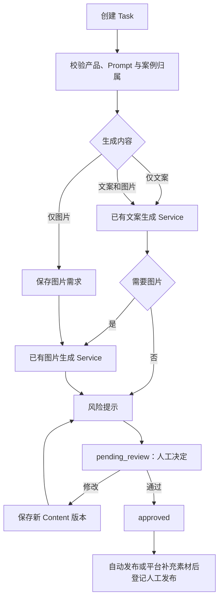

# LangGraph 素材工作流

工作流负责调用已有 Service 与持久化进度，不在节点中重复实现 RAG、文本模型或生图调用。



风险、检查失败及未配置规则均不阻止素材保存或人工审核。人工审核仍要求最新版本、所属用户及有效任务状态，审核通过不自动发布。

## 创建和启动

先 `POST /tasks` 选择产品和平台，填写 `input_text`。再调用：

```http
POST /tasks/{task_id}/workflow/start
Authorization: Bearer <token>
```

```json
{
  "output_mode": "images",
  "prompt_id": null,
  "analysis_ids": [],
  "model_id": null,
  "image_style_requirement": "简洁自然光",
  "image_count": 1,
  "image_size": "1728*2368"
}
```

`output_mode` 为 `text`、`images` 或 `text_images`，默认仅文案。仅图片不会调用营销文案生成；创建图片需求后直接调用现有配图 Service，成功保存的素材可以单独审核和下载。产品资料和检索仍按用户、产品隔离，事实只依据产品 RAG。案例只作创作参考。

文案生成参数继续支持 `top_k`、`min_similarity`、`max_context_chars`、`use_memory` 和 `memory_limit`。模型选择见 [模型连接](model_connections.md)。

## 查询和恢复

`GET /tasks/{id}/workflow` 返回 `task_status`、图阶段、Content ID、版本、风险提示、下一节点及审核中断。取消后查询优先显示 `cancelled`。旧记录的 `waiting_rule_changes` 可以提交当前版本审核，避免伪造修改。

`POST /tasks/{id}/workflow/resume` 的操作：

| action | 作用 |
| --- | --- |
| `submit_changes` | 保存新版本后提交；版本必须高于图内版本 |
| `submit_review` | 将当前已保存的同一版本提交人工审核，不重新付费检查 |
| `recheck` | 自愿重新检查当前版本，风险继续作为提示 |
| `review` | 同步已通过审核接口保存的通过或驳回决定 |
| `regenerate` | 重新生成，可通过 `generation` 更换生成模式及参数 |

审核先调用 `POST /reviews`，再恢复 `review`。驳回需要修改意见，原版本不能直接重复提交。修改后新增 Content，重新提交和审核；审批及发布不会误用历史版本。

## 失败、重试和持久化

图在审核节点通过 LangGraph 中断持久化。检查点不保存 API Key、数据库 Session 或浏览器对象，业务身份从认证 Session 传入。跨进程执行锁避免同一工作流并发运行。

`POST /tasks/{id}/workflow/retry` 恢复失败步骤。文案步骤按生成键复用已保存内容，图片步骤也有独立生成键：图片已提交而检查点保存失败时直接复用，避免重复付费及重复创建版本。生图失败保留文案或图片需求；风险检查服务不可用时保留提示并进入人工审核。

真实发布是独立操作。自动发布继续核对审核版本、账号、素材摘要和可见范围；结果未知不能直接重复发布。只生成部分素材时，在平台补齐后登记作品链接、实际账号及最终文案说明，见 [素材生成与人工决定](flexible_materials.md)。
